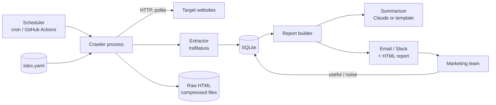
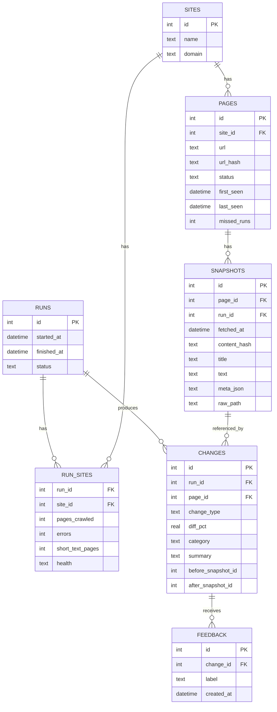
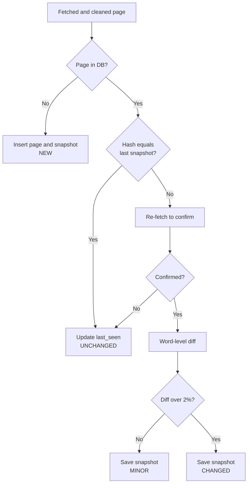
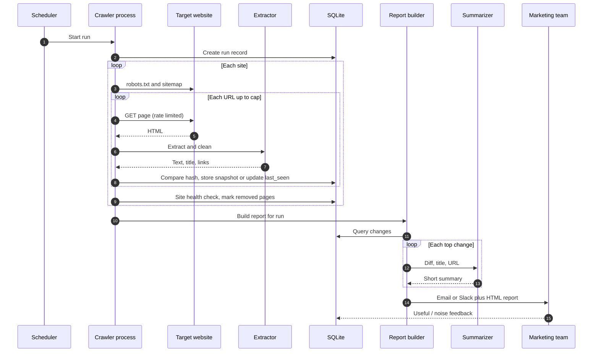

# Competitor Site Monitor: PRD and Technical Design

| | |
|---|---|
| **Project** | Competitor Site Monitor (marketing web crawler) |
| **Version** | 1.0 (draft) |
| **Date** | 14 Oct 2026 |
| **Status** | Ready for review |
| **Scale** | Low (about 10 websites, crawled 2-3 times per week) |

**Contents**

- Part A: Product Requirements Document (PRD)
- Part B: Technical Design Document

---

# Part A: Product Requirements Document

## 1. Overview

The marketing team needs up-to-date information about a fixed set of about 10 websites (competitors, partners, or industry sources). Today this is done by manual browsing, which is slow, inconsistent, and easy to miss. This product crawls those sites on a schedule, stores their content, detects what changed, and delivers a short, trustworthy summary of what is new.

## 2. Problem Statement

- Marketing learns about competitor pricing, product launches, and messaging changes late or by accident.
- Manual checks do not scale across 10 sites and leave no history.
- Raw crawlers produce noisy output (every page "changed"), so the team stops trusting them.

## 3. Goals and Non-Goals

### Goals

1. Crawl the configured sites automatically 2-3 times per week (Mon / Wed / Fri).
2. Store page content and keep a history of changes.
3. Deliver a weekly-style summary: new pages, changed pages, removed pages, and the key takeaways.
4. Make every reported item verifiable (link to the live URL, saved snapshot, and before/after text).
5. Be polite and compliant: respect robots.txt, rate limits, and site terms.
6. Be simple to run and maintain by one person on a small machine.

### Non-Goals (v1)

- Crawling the open web or discovering new sites.
- Bypassing logins, paywalls, CAPTCHAs, or anti-bot protections.
- Real-time monitoring or alerts within minutes.
- Large-scale or distributed crawling.
- Building a search engine or full web UI (a simple HTML report is enough).
- Collecting personal data (user comments, emails, forum posts).

## 4. Users and Personas

| Persona | Needs |
|---|---|
| **Marketing manager** (primary reader) | A short summary of what changed and why it matters. Links to verify. |
| **Content / SEO specialist** | New blog posts, page title and headline changes, new landing pages. |
| **Product marketer** | Pricing, plan, and feature changes. |
| **Maintainer** (engineer or analyst) | Easy config, clear logs, health indicators, low maintenance. |

## 5. User Stories

| ID | Story | Priority |
|---|---|---|
| US-1 | As a marketer, I receive a report after each crawl listing new, changed, and removed pages so I do not have to check sites manually. | Must |
| US-2 | As a marketer, I see the top changes first, each with a 1-2 sentence summary and a link, so I can read it in under 5 minutes. | Must |
| US-3 | As a marketer, I can click through to the live page and see the before/after text to verify a change. | Must |
| US-4 | As a marketer, I see pricing changes called out separately. | Should |
| US-5 | As a maintainer, I can add or remove a site by editing a config file, without code changes. | Must |
| US-6 | As a maintainer, I can see per-site crawl health so I know if a crawl was incomplete. | Must |
| US-7 | As a marketer, I can mark a change as "useful" or "noise" so the system improves. | Could |
| US-8 | As a marketer, I can search or export stored content to CSV. | Could |

## 6. Functional Requirements

### 6.1 Site configuration

- **FR-1** Sites are defined in a YAML file: name, start URL, optional sitemap URL, allowed path patterns, excluded patterns, max pages, max depth, delay between requests, and a `render_js` flag.
- **FR-2** Adding or removing a site requires no code change.

### 6.2 Crawling

- **FR-3** The crawler runs on a schedule (default Mon / Wed / Fri) and can also be triggered manually.
- **FR-4** For each site, URLs are seeded from `sitemap.xml` if available, otherwise by following internal links up to the configured depth.
- **FR-5** Only allowlisted domains are crawled. External links are ignored.
- **FR-6** robots.txt is fetched and honored for every site. Disallowed URLs are skipped.
- **FR-7** Requests are rate limited per site (default one request at a time, 2-3 seconds apart) and use a clear User-Agent with contact information.
- **FR-8** Hard limits apply per site: max pages, max depth, max page size (2 MB), and request timeout (20 s).
- **FR-9** URLs are normalized (lowercase host, strip fragments and tracking parameters such as `utm_*`, sort query parameters) and junk URLs (search, login, cart, calendar, file downloads) are skipped.
- **FR-10** Failed requests are retried with exponential backoff. HTTP 429 and 503 trigger slow-down behavior.
- **FR-11** A per-site circuit breaker stops crawling a site if more than 30% of its requests fail. Other sites continue.

### 6.3 Content extraction and storage

- **FR-12** For each page, the system extracts title, main text (without navigation, footer, and cookie banners), meta description, headings, publish date if present, and outgoing internal links.
- **FR-13** Dynamic noise (timestamps, counters, rotating banners) is stripped before hashing.
- **FR-14** A new snapshot is stored only when the content hash changes. The last N raw HTML snapshots are kept for debugging.
- **FR-15** Pages with very little extracted text (under 200 characters) are flagged as possibly JavaScript-rendered. Sites with `render_js: true` use a headless browser.

### 6.4 Change detection and verification

- **FR-16** Each page is classified per run as NEW, CHANGED, MINOR (under 2% text difference), UNCHANGED, or REMOVED.
- **FR-17** A detected change is confirmed by fetching the page a second time before it is reported. This filters out glitches and A/B variants.
- **FR-18** Pages are marked REMOVED only after missing for 2 consecutive healthy crawls, and never when the site's crawl is flagged incomplete.
- **FR-19** Key structured fields (for example price, plan name) can be extracted with simple CSS selector or regex rules. Missing or out-of-range values are flagged.

### 6.5 Reporting

- **FR-20** After each run, a report is generated with: crawl health, top changes, per-site changes, removed pages, and items needing review.
- **FR-21** Each reported change has a classification (pricing, product/feature, blog/news, messaging, removed), a short factual summary, the URL, fetch time, and a link to the before/after diff.
- **FR-22** Summaries are generated from the diff, title, and URL only. A summary that does not reference the changed text is rejected and regenerated, or falls back to a template.
- **FR-23** The report is delivered by email and/or a Slack webhook, with a full HTML report attached or linked.

## 7. Non-Functional Requirements

| Area | Requirement |
|---|---|
| **Scale** | Up to about 10 sites, up to about 500 pages per site (about 5,000 pages per run). |
| **Run time** | A full run completes in under 3 hours (dominated by polite delays). |
| **Reliability** | One failing site must not stop the others. A crashed run can be restarted safely without duplicate data. |
| **Compliance** | Honors robots.txt, rate limits, and identifies itself. No login or CAPTCHA bypass. No personal data stored. |
| **Security** | Secrets (SMTP, Slack webhook, API keys) in environment variables, never in config files or git. |
| **Maintainability** | Under about 1,500 lines of Python. Config-driven. Structured logs. |
| **Cost** | Runs on a small VM or GitHub Actions. LLM cost is low (diffs only). |
| **Data retention** | Snapshots kept 12 months. Raw HTML for the last 3 snapshots per page. |

## 8. Success Metrics

| Metric | Target |
|---|---|
| Crawl completion rate (sites completed without breaker trip) | 95% or higher |
| Report delivered on schedule | 100% of scheduled runs |
| Noise rate (changes marked "noise" by marketing) | Under 20% after 1 month of tuning |
| Missed important changes (found manually but not reported) | Under 5% |
| Time for marketing to review a report | Under 5 minutes |
| Spot-check accuracy (stored text matches live page) | 95% or higher |

## 9. Report Specification

```
Competitor Update, <date>

Crawl health: 10/10 sites OK, 2,431 pages checked

Top changes
1. Site A: Pro plan price raised $29 -> $39  [link] [diff]
2. Site B: New page "AI Assistant" launched  [link]
3. Site C: Homepage headline changed         [link] [diff]

By site
  Site A: 1 pricing change, 3 new blog posts
  Site B: 1 new product page
  ...

Removed pages: 4  |  Needs review: 1 (Site D, possible crawl failure)
```

Rules: top 5-10 changes first; every item has a link and before/after text; if the crawl was incomplete the report says so instead of claiming pages were removed.

## 10. Assumptions, Dependencies, Risks

### Assumptions

- Target sites are public marketing pages that can be fetched without login.
- Most sites provide a sitemap or are crawlable by plain HTTP.
- The team will give feedback ("useful" / "noise") in the first month.

### Dependencies

- Python 3.11+, SQLite, a scheduler (cron or GitHub Actions).
- SMTP account or Slack webhook for delivery.
- Optional: Anthropic API key for summaries (template fallback otherwise).

### Risks and Mitigations

| Risk | Impact | Mitigation |
|---|---|---|
| Site blocks the crawler | Missing data | Slow down, check for sitemap or API, flag in report. Do not circumvent blocks. |
| Site terms forbid crawling | Legal exposure | Review terms per site before onboarding. Remove site if disallowed. |
| Noisy diffs | Team loses trust | Strip dynamic content, change confirmation, minor threshold, feedback loop. |
| JS-rendered sites return empty content | Silent gaps | Short-text flag, per-site Playwright option. |
| Site redesign breaks extraction | False "changed" or "removed" | Health check on page counts and text length, "needs review" status. |
| LLM summary inaccuracy | Wrong conclusions | Diff-only input, citation check, link to source on every item. |

## 11. Milestones

| Phase | Scope | Estimate |
|---|---|---|
| **M1: Core crawler** | Config, fetch, robots, rate limit, extraction, SQLite storage | 1 week |
| **M2: Change detection** | Hashing, noise stripping, confirmation, diffs, health checks | 1 week |
| **M3: Reporting** | Classification, summaries, HTML report, email/Slack delivery, scheduler | 1 week |
| **M4: Hardening and pilot** | Spot checks, tuning, feedback capture, docs | 1 week |

## 12. Open Questions

1. Which 10 sites, and has each site's terms of service been reviewed?
2. Which delivery channel: email, Slack, or both? Who is on the distribution list?
3. Which sites need JavaScript rendering?
4. Should the summary use an LLM, or start with templates only?
5. Is there a field-level list of important data points (for example price per plan) to extract?
6. Where will it run (own machine, small VM, GitHub Actions)?

---

# Part B: Technical Design Document

## 1. Architecture Overview

A single scheduled Python process crawls sites one at a time, stores results in SQLite, then generates and sends a report. There are no queues, no workers, and no external services beyond optional LLM and email/Slack.



### Design principles

- **Simple first**: one process, one database file, sequential per site.
- **Idempotent**: re-running a crawl does not create duplicate data.
- **Isolated failures**: each site runs inside its own error boundary.
- **Config-driven**: behavior changes via YAML, not code.
- **Verifiable output**: every claim in a report traces to a URL and a stored snapshot.

## 2. Technology Stack

| Concern | Choice | Notes |
|---|---|---|
| Language | Python 3.11+ | |
| HTTP | `httpx` | Timeouts, retries, HTTP/2, easy to control |
| robots.txt | Small RFC 9309 parser (`domain/robots.py`) | `urllib.robotparser` ignores `*`/`$` wildcards and longest-match. Cached per host per run. |
| Sitemap | `ultimate-sitemap-parser` or small custom parser | Handles sitemap indexes |
| HTML parsing | `selectolax` or `beautifulsoup4` | Link extraction, selectors |
| Main text extraction | `trafilatura` | Strips nav/footer/boilerplate |
| JS rendering (optional) | `playwright` | Only for sites with `render_js: true` |
| Storage | SQLite (`sqlite3` / SQLAlchemy) | Single file, WAL mode |
| Raw HTML | gzip files on disk | Keyed by URL hash and fetch time |
| Diff | `difflib` | Word-level diff for readability |
| Config | YAML (`pydantic` for validation) | Fail fast on bad config |
| Templates | `jinja2` | HTML and email |
| Summaries | Anthropic API (optional) | Template fallback |
| Delivery | `smtplib` and/or Slack webhook | |
| Logging | `structlog` or stdlib `logging` (JSON) | |
| Scheduling | cron or GitHub Actions | |
| Tests | `pytest`, `respx` (HTTP mocking) | |

## 3. Project Structure

```
site-monitor/
├── config/
│   └── sites.yaml
├── src/monitor/
│   ├── main.py              # CLI entrypoint (run, report, init-db)
│   ├── config.py            # YAML loading and validation
│   ├── crawler.py           # per-site crawl loop
│   ├── fetcher.py           # HTTP client, retries, backoff, rate limit
│   ├── robots.py            # robots.txt cache and checks
│   ├── urls.py              # normalization, filtering, allowlist
│   ├── extractor.py         # trafilatura wrapper, noise stripping
│   ├── change.py            # hashing, diffing, classification of changes
│   ├── health.py            # per-site health checks and circuit breaker
│   ├── db.py                # schema, queries
│   ├── report/
│   │   ├── builder.py       # collect, rank, assemble
│   │   ├── summarizer.py    # LLM + template summaries
│   │   ├── templates/       # jinja2 HTML and email
│   │   └── delivery.py      # email, Slack
│   └── logging_setup.py
├── data/
│   ├── monitor.db
│   └── raw/                 # gzip HTML snapshots
├── reports/                 # generated HTML reports
├── tests/
├── .env.example
├── pyproject.toml
└── README.md
```

## 4. Configuration

### 4.1 `sites.yaml`

```yaml
defaults:
  delay_seconds: 2.5
  max_pages: 500
  max_depth: 3
  timeout_seconds: 20
  max_bytes: 2097152
  user_agent: "SiteMonitor/1.0 (contact: marketing-it@example.com)"
  exclude_patterns:
    - "/search"
    - "/login"
    - "/cart"
    - "/tag/"
    - "?page="
    - "\\.(pdf|zip|mp4|png|jpg|jpeg|gif)$"

sites:
  - name: Competitor A
    start_url: https://www.competitor-a.com/
    sitemap_url: https://www.competitor-a.com/sitemap.xml
    allow_patterns: ["^/(pricing|product|blog|features)"]
    render_js: false
    extractors:                # optional structured fields
      price:
        selector: ".plan-pro .price"
        type: number

  - name: Competitor B
    start_url: https://competitor-b.io/
    render_js: true
    max_pages: 200
```

### 4.2 Environment variables

| Variable | Purpose |
|---|---|
| `SMTP_HOST`, `SMTP_USER`, `SMTP_PASSWORD`, `REPORT_FROM`, `REPORT_TO` | Email delivery |
| `SLACK_WEBHOOK_URL` | Slack delivery |
| `GEMINI_API_KEY` | Optional LLM summaries |
| `DATA_DIR` | Location of DB and raw files |

## 5. Data Model



### Key constraints

- `pages`: `UNIQUE(site_id, url_hash)`.
- `snapshots`: a new row is inserted only when `content_hash` differs from the latest row for that page.
- `pages.status`: `active`, `removed`.
- `pages.missed_runs`: incremented when a page is not seen in a healthy run. Page becomes `removed` at 2.
- `change_type`: `NEW`, `CHANGED`, `MINOR`, `REMOVED`.
- `category`: `pricing`, `product`, `blog`, `messaging`, `other`, `removed`.
- `run_sites.health`: `ok`, `degraded`, `failed`, `needs_review`.

SQLite is run with WAL mode and foreign keys on. Indexes: `pages(site_id, status)`, `snapshots(page_id, fetched_at DESC)`, `changes(run_id)`.

## 6. Component Design

### 6.1 Crawler (`crawler.py`)

Per site, sequentially:

1. Fetch and parse robots.txt (if unreachable, apply the safe default of treating the site as allowed only for the start URL and log a warning).
2. Build the URL list: sitemap first, then link discovery from the start URL (breadth-first, depth-limited) as backup or supplement.
3. Normalize and filter each URL (`urls.py`).
4. Process URLs until the list is empty or the page cap is hit. For each URL: robots check, wait, fetch, extract, change-detect, store.
5. Run the site health check and update page statuses.

A per-site `try/except` ensures an unexpected exception marks the site `failed` and the run continues.

### 6.2 Fetcher (`fetcher.py`)

- One `httpx.Client` per site with the configured User-Agent, timeout, and size limit (stream and abort above `max_bytes`).
- Rate limit: sleep `delay_seconds` (plus small random jitter) between requests to the same site.
- Retry policy: up to 3 attempts for timeouts, connection errors, and 5xx. Backoff `2^n` seconds.
- `429` / `503`: honor `Retry-After` if present, otherwise back off and double the site's delay for the rest of the run.
- Conditional requests: send `If-None-Match` / `If-Modified-Since` when stored, and treat `304` as unchanged.
- Only HTML content types are processed. Others are skipped.
- Redirects followed (max 5). The final URL is stored, and redirects leaving the allowlisted domain are dropped.
- If `render_js` is true, the fetch goes through a shared Playwright browser with the same delay and limits.

### 6.3 URL handling (`urls.py`)

- Normalize: lowercase scheme and host, remove fragment, remove tracking parameters (`utm_*`, `gclid`, `fbclid`, `ref`), sort query parameters, strip trailing slash (except root).
- Allowlist: same registered domain (and configured subdomains).
- Allow patterns (if set) must match. Exclude patterns must not match.
- Guard against crawler traps: max URL length (300 chars), max query parameters (3), max path depth, and a per-site page cap.

### 6.4 Extractor (`extractor.py`)

- `trafilatura.extract()` for main text, with title and metadata.
- Link extraction from the full HTML (not just main text) for discovery.
- Noise stripping before hashing: regexes for dates/times, "X views", "last updated", cookie text, and CSS-selector-based removal of configured elements (for example `.banner`, `.ticker`).
- Normalize whitespace and Unicode. Hash is SHA-256 of the cleaned text.
- Flag `short_text` when cleaned text is under 200 characters.
- Optional structured field extraction via configured selectors or regexes.

### 6.5 Change detection (`change.py`)



- Diff percentage = changed words divided by total words (max of before and after).
- The re-fetch happens after a short delay, and the second hash must match the first fetch's hash to confirm.
- Structured fields (such as price) are compared separately, and a change in a tracked field is always at least `CHANGED`, regardless of the 2% threshold.

### 6.6 Health and circuit breaker (`health.py`)

| Check | Rule | Action |
|---|---|---|
| Error rate | More than 30% of requests failed (after at least 20 requests) | Trip breaker, stop the site, mark `failed` |
| Page count drop | Pages crawled less than 70% of previous run | Mark `needs_review`, skip removal marking |
| Short text | More than 20% of pages have under 200 chars | Mark `degraded`, suggest `render_js` |
| Blocked | Repeated 403/429 on the start URL | Stop the site, mark `failed` |

Removed-page logic runs only for sites with health `ok` or `degraded`. A page is marked `removed` after being missing in 2 consecutive healthy runs, or immediately on a confirmed 404/410 (confirmed by a second fetch).

### 6.7 Report builder (`report/`)

1. **Collect**: changes for the current run (`NEW`, `CHANGED`, `REMOVED`) with before/after text.
2. **Filter**: drop `MINOR` (listed only as a count), drop pages from sites flagged `failed`.
3. **Classify**: rule-based first (URL and text keywords: `pricing`, `plan`, `$`, `/blog/`, `/product/`). The LLM may refine ambiguous cases.
4. **Rank**: pricing first, then new product/feature pages, then messaging changes, then blog posts, then removals.
5. **Summarize**: 1-2 sentences per top change (see 6.8).
6. **Render**: Jinja2 HTML report (saved to `reports/`) and a compact email/Slack version with the top changes.
7. **Deliver**: send, and record delivery status. If delivery fails, the HTML report is still saved and an error is logged.

HTML report includes per-change before/after diff views (word-level highlight), so verification is one click away.

### 6.8 Summarizer (`report/summarizer.py`)

**LLM mode** (optional):

- Input per change: URL, page title, category, and a trimmed word-level diff (added and removed text, capped around 2,000 characters). No other context.
- System prompt rules: be factual, 1-2 sentences, mention only what appears in the diff, quote prices and names exactly, answer `NO_NOTABLE_CHANGE` if the change is cosmetic.
- Validation: the summary must include at least one number, name, or phrase that appears in the diff (simple substring check). If it fails, retry once, then fall back to the template.
- Model name is read from config so it can be updated without code changes.

**Template mode** (fallback and default):

```
{site}: "{title}" updated, {added} words added, {removed} words removed.
New heading: "{first_new_heading}"        # if any
Price field: {old} -> {new}               # if tracked field changed
```

### 6.9 Delivery (`report/delivery.py`)

- Email via SMTP (HTML body plus attached full report).
- Slack via webhook (top 5-10 changes plus a link or attached file).
- Both are optional and independently enabled by config.

### 6.10 Feedback loop

- Each reported change in the HTML report carries "useful" and "noise" links that point to a simple endpoint, or, to stay serverless, the report includes a list of change IDs and the team marks them in a shared sheet that is imported with `monitor feedback import file.csv`.
- Feedback is stored in `feedback` and used monthly to adjust exclude patterns and noise-stripping rules. It does not automatically change behavior in v1.

## 7. End-to-End Sequence



## 8. CLI

```
monitor init-db                      # create tables
monitor run [--site NAME] [--dry-run]  # crawl all sites or one
monitor report [--run-id N] [--send]  # (re)build and optionally send a report
monitor health                       # show last run health per site
monitor feedback import FILE.csv     # import useful/noise labels
monitor prune --older-than 365d      # retention cleanup
```

`--dry-run` crawls and reports to the console without writing to the database, which is useful when onboarding a new site.

## 9. Scheduling and Deployment

**Option A: cron on a small VM or local machine**

```
0 6 * * 1,3,5  cd /opt/site-monitor && .venv/bin/monitor run && .venv/bin/monitor report --send
```

**Option B: GitHub Actions (scheduled)**

- Workflow with `cron: "0 0 * * 1,3,5"` (UTC).
- Persist `monitor.db` and raw files between runs using a release asset, cache, or a committed artifact branch. A small VM is simpler if the database grows.
- Secrets stored in GitHub Secrets.

**Operational notes**

- Back up `monitor.db` weekly (a file copy after `PRAGMA wal_checkpoint`).
- Use a lock file so two runs cannot overlap.
- Set a global run timeout (for example 4 hours) after which remaining sites are marked `skipped` and the report says so.

## 10. Error Handling Summary

| Situation | Behavior |
|---|---|
| Network error or timeout | Retry with backoff, then log and count as failure |
| HTTP 429 / 503 | Honor `Retry-After`, slow down, then retry |
| HTTP 403 repeatedly | Stop site, mark `failed`, never circumvent |
| HTTP 404 / 410 | Confirm with second fetch, mark removal candidate |
| Page too large or non-HTML | Skip and log |
| Extraction fails or empty text | Flag `short_text`, keep going |
| Unhandled exception in a site | Mark site `failed`, continue with next site |
| LLM error or invalid output | Fall back to template summary |
| Email/Slack delivery fails | Save report locally, log error, retry on next `report --send` |
| DB write error | Fail the run loudly. Writes for a page happen in one transaction. |

## 11. Security, Privacy, and Compliance

- Honor robots.txt, rate limits, and each site's terms of service. Review terms before onboarding a site.
- Identify the crawler with an accurate User-Agent and a monitored contact address.
- Do not log in, solve CAPTCHAs, rotate IPs, or spoof browsers to evade blocks.
- Store only public marketing content. Strip or skip comment sections, user profiles, and anything that looks like personal data (email addresses, phone numbers).
- Keep secrets in environment variables. Do not commit `.env`.
- Treat page content as untrusted input: when passing diffs to an LLM, instruct the model to ignore any instructions found inside the content, and never let it trigger actions.
- Sanitize any page text rendered into the HTML report (escape HTML).
- Respect copyright: the stored content is for internal analysis and the report should summarize and link, not republish full competitor content.

## 12. Observability

- **Logs**: structured JSON per request (site, url, status, bytes, duration, outcome) and per run summary.
- **Run summary stored in DB** (`run_sites`): pages crawled, errors, short-text count, health, duration.
- **Alerts**: send an email or Slack message to the maintainer if a run fails, a site's health is `failed` twice in a row, or no report was generated by the expected time.
- **Health section at the top of every report** so the marketing team sees data quality at a glance.

## 13. Testing Strategy

| Level | What | Tools |
|---|---|---|
| Unit | URL normalization, filters, noise stripping, hashing, diff percentage, classification rules | `pytest` |
| Component | Fetcher retry/backoff, robots handling, change detection flow with fixture HTML | `pytest`, `respx` |
| Integration | Full run against a local mock site (static files served by `http.server`) including change, add, remove scenarios | `pytest` |
| Regression | Saved real HTML samples per site to check extraction does not break after code changes | Fixture files |
| Manual QA | Weekly spot check of 5 random pages per site in the first month: stored text vs live page | Checklist |
| Report review | Marketing reviews the first 3 reports and labels items useful/noise | Feedback import |

**Acceptance criteria for go-live**

- A full run on all 10 sites completes with no unhandled errors.
- Re-running with no site changes produces zero CHANGED items (noise check).
- A manually edited test page is detected and reported correctly with a working diff link.
- Disallowed robots.txt paths are never requested (verified from logs).
- Report is delivered to the intended channel.

## 14. Performance and Capacity Estimates

- 10 sites x 500 pages = 5,000 requests per run.
- At about 3 s per request (delay plus fetch), sequential time is roughly 4 hours. To keep runs shorter, either reduce the cap, lower the delay to 1.5-2 s where the site allows it, or crawl 2-3 different sites in parallel (still one request at a time per site).
- Storage: about 50 KB of text per page and about 100 KB raw gzip, so roughly 0.5 GB per full snapshot set. With changes-only snapshots and retention rules, a few GB per year at most.
- SQLite handles this comfortably.

## 15. Future Enhancements (out of scope for v1)

- Simple web dashboard with search, diff history, and feedback buttons.
- Competitor "timelines" per site (pricing history charts).
- Screenshot capture and visual diff for key pages.
- Semantic change detection with embeddings for messaging shifts.
- Keyword and topic alerts (for example any page mentioning a specific product name).
- Move to Postgres and a queue if the site count grows well beyond 10.

## 16. Implementation Checklist

- [ ] Finalize list of 10 sites and review each site's terms of service
- [ ] Set up repo, `pyproject.toml`, and `.env.example`
- [ ] Implement config loader with validation
- [ ] Implement fetcher with rate limit, retry, robots, and size limits
- [ ] Implement URL normalization and filtering
- [ ] Implement extractor and noise stripping
- [ ] Create SQLite schema and data-access layer
- [ ] Implement change detection with confirmation re-fetch
- [ ] Implement health checks and circuit breaker
- [ ] Implement report builder, templates, and delivery
- [ ] Add LLM summarizer with template fallback
- [ ] Add cron or GitHub Actions schedule and lock file
- [ ] Write tests and run the go-live acceptance checks
- [ ] Pilot for 2 weeks with spot checks, then tune rules from feedback
