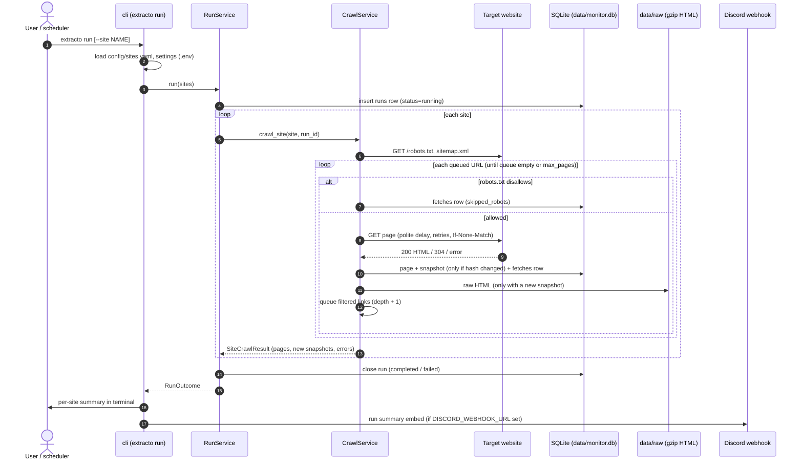
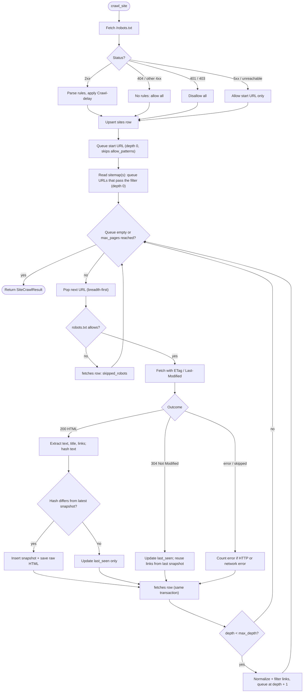
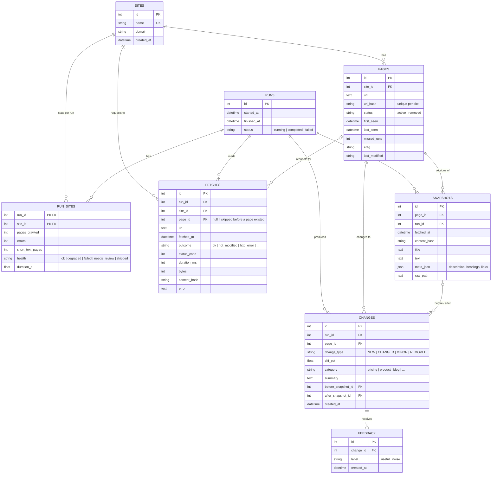
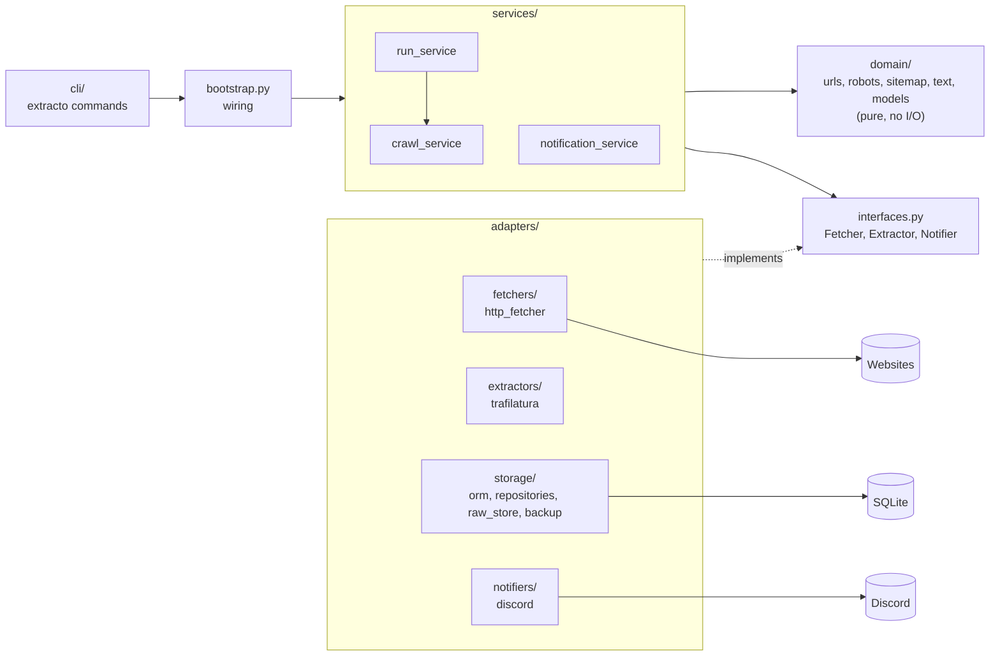

# Extracto diagrams

Mermaid diagrams render on GitHub and in VS Code (Markdown preview, or the "Markdown Preview
Mermaid Support" extension). Paste any block into https://mermaid.live to edit it.

## 0. Production on Render (free tier)

```mermaid
sequenceDiagram
    autonumber
    participant Cron as cron-job.org
    participant App as Render web service (extracto serve)
    participant Web as Target websites
    participant DB as Neon Postgres
    participant Discord as Discord webhook

    Cron->>App: GET /healthz (every 10 min in the crawl window; wakes / keeps awake)
    Cron->>App: POST /runs + X-API-Key (Mon/Wed/Fri 06:00 UTC)
    App->>DB: stale-run check, insert runs row (running)
    App-->>Cron: 202 {run_id, status_url}
    loop each site in sites.yaml (background thread)
        App->>Web: robots.txt, sitemap, pages (polite)
        App->>DB: pages, snapshots (only on change), fetches
    end
    App->>DB: close run (completed / failed)
    App->>Discord: summary: stats + new/updated pages (or baseline)
```

## 1. `extracto run`, end to end



## 2. Crawling one site (`CrawlService.crawl_site`)



## 3. Database schema



## 4. Code layers


